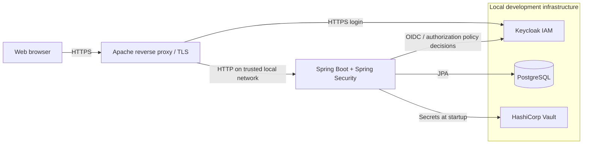

# Secure Requests & Approvals

**A security-focused request and approval web application**, built as an academic project to explore secure Java backend development, Identity & Access Management (IAM), secret management and practical security assessment.

> **Portfolio project, not a production deployment.** This repository contains a sanitized copy of the source code and local configuration examples. Real secrets, TLS private keys, database backups, complete security reports, identity-provider exports and personal university documents have intentionally been excluded.

## At a glance

- **Users** can authenticate, submit requests, view their own requests and track their statuses (`PENDING`, `APPROVED`, `REJECTED`).
- **Administrators** can review submitted requests and approve or reject them, subject to centrally enforced authorization policies.
- **Security controls** cover OAuth 2.0/OpenID Connect login, fine-grained authorization, secret management, TLS termination, input validation and security testing.
- **Additional account workflows** include profile viewing, password/email changes and account deletion through the relevant Keycloak integration.

## Architecture



The web application is written in **Java 17 / Spring Boot 3.2.3** and uses **Spring MVC, Thymeleaf, Spring Security, Spring Data JPA, PostgreSQL, Keycloak, HashiCorp Vault and Docker Compose**. The reverse proxy is an external component in the original setup; the Compose file provisions the supporting services, not the application or Apache.

## Security design

| Concern | Implementation |
|---|---|
| Authentication | OpenID Connect Authorization Code Flow via Keycloak + Spring Security |
| Authorization | Keycloak Authorization Services, with resource/scope permission checks in `KeycloakPdpService` |
| User data isolation | Requests are retrieved and managed using the authenticated principal, not a user ID supplied by the browser |
| Secrets | Database credentials and Keycloak client secret are requested from Vault at runtime |
| Transport protection | Apache HTTPS/TLS termination in the original lab environment |
| Database | Spring Data JPA with PostgreSQL; database is logically separate from identity administration |
| Security assessment | Academic threat modeling (IriusRisk / STRIDE), mitigation review and DAST with OWASP ZAP |

This repository demonstrates the implemented controls; it does **not** imply an independent security audit, vulnerability-free software or production hardening.

## Project structure

```text
secure-requests-approvals/
├── src/main/java/              # Spring application, controllers, services, security
├── src/main/resources/
│   ├── templates/              # Thymeleaf pages
│   └── application.properties  # Environment/Vault-based configuration
├── src/test/java/              # Original starter test
├── docker-compose.yml          # Local PostgreSQL, Keycloak, Vault
├── .env.example                # Variable names with non-secret placeholders
├── docs/LOCAL_SETUP.md         # Configuration and startup requirements
├── docs/SECURITY_NOTES.md      # Public-release precautions and limitations
└── pom.xml                     # Maven dependencies
```

## Run locally

You need **Java 17+**, Maven (or the included Maven wrapper, which may download files), **Docker Compose**, and an HTTPS reverse proxy / local certificates for the `requests.local` and `auth.local` development names.

1. Copy `.env.example` to `.env` and supply **new local passwords** (do not reuse real credentials).
2. Start the supporting services: `docker compose up -d`.
3. Initialize/unseal Vault, configure its KV secrets and obtain a local token.
4. Configure the Keycloak realm `requests-approvals`, the confidential client `requests-app`, OIDC login, roles and the resource/scope permissions checked by the backend.
5. Configure the local HTTPS names and reverse proxy, then start the Spring Boot application with `VAULT_TOKEN` provided through your environment.

**Important:** Simply cloning the repository and running Docker Compose is **not sufficient** to launch the full application: Vault, Keycloak, and local TLS certificates require manual configuration. See [Local setup](docs/LOCAL_SETUP.md) for details and [Security notes](docs/SECURITY_NOTES.md) before publishing or deploying.

## Academic security validation

The academic investigation included:

- Threat modeling using IriusRisk and the STRIDE categories, with mitigation review against applicable controls.
- Reconciling authorization logic, preventing access to other users' requests and protecting administrator actions.
- Dynamic application security testing with OWASP ZAP, including reviewing alerts and making hardening changes such as avoiding duplicate anti-clickjacking headers.

Assessment reports may contain sensitive request/response examples or local configuration and are **not included** in this public portfolio version.

## What I learned

Secure application architecture; Spring Security and OAuth 2.0/OIDC; fine-grained IAM policy enforcement; encryption and PKI fundamentals; containerized services and databases; secrets management; threat modeling, vulnerability assessment and secure configuration.

## Author and context

**Vincenzo Bosco** — academic cybersecurity and software engineering project, University of Naples Federico II.

This repository is a portfolio artifact. No open-source license has been granted here; contact the author for reuse permissions.
